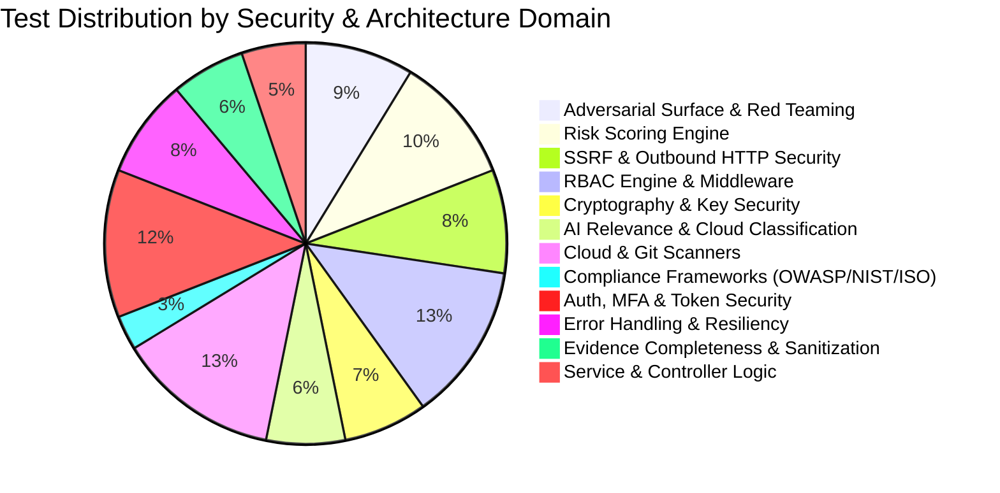
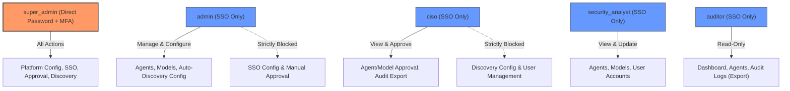

# Drisvia Platform: Comprehensive Unit Testing & Quality Audit Report

---

## 1. Executive Summary & Verification Metrics

To ensure enterprise-grade resilience, regulatory compliance, and security assurance for the **Drisvia AI Agent Discovery & Governance Platform**, a deep unit testing suite was implemented across the platform's core algorithmic, cryptographic, security, and administrative modules.



### High-Level Metrics Comparison

| Metric                          |  Baseline State  | Current Audited State |              Delta               |
| :------------------------------ | :--------------: | :-------------------: | :------------------------------: |
| **Total Test Suites**           |     6 files      |     **20 files**      |            **+233%**             |
| **Total Test Cases**            |     73 tests     |     **252 tests**     |            **+245%**             |
| **Execution Speed**             |     ~508 ms      |      **~828 ms**      |     Fast execution (< 1 sec)     |
| **Failed Tests**                |        0         |         **0**         |          **100% Pass**           |
| **External Dependencies**       | None (pure unit) |  **None (hermetic)**  |       In-memory execution        |
| **Cryptographic Tamper Checks** |        0         |   **6 test cases**    |      Full GCM verification       |
| **SSRF Target Vectors Tested**  |        0         | **7 attack vectors**  | AWS IMDS, loopback, private CIDR |

---

## 2. Core Architectural Domains Tested

### 2.1. Cryptography & Secrets Management (`AES-256-GCM`)

_Source: [`server/src/lib/encryption.ts`](file:///d:/Apnto/Drisvia/Product/server/src/lib/encryption.ts)_  
_Test File: [`server/src/lib/encryption.test.ts`](file:///d:/Apnto/Drisvia/Product/server/src/lib/encryption.test.ts) (17 Tests)_

The discovery platform encrypts all cloud credentials, service principal secrets, and access tokens before persisting them into PostgreSQL. The unit tests verify the cryptographic contract:

- **Key Validation (`assertEncryptionKey`)**: Asserts that `DISCOVERY_ENCRYPTION_KEY` is strictly a 64-character hexadecimal string (32 bytes). Tests explicitly reject absent keys, empty strings, truncated 32-character keys, oversized keys, and non-hex characters.
- **Envelope Formatting**: Validates standard `iv:authTag:ciphertext` Base64 encoding using a 96-bit (12-byte) IV and a 128-bit (16-byte) authentication tag.
- **Probabilistic Security**: Confirms that encrypting the same payload twice generates distinct IVs and distinct ciphertexts.
- **Cryptographic Tampering Detection**:
  - Flipping bits in the ciphertext throws an AEAD tag mismatch exception.
  - Modifying the authentication tag throws an AEAD validation failure.
  - Modifying the IV prevents decryption.
  - Attempting decryption using a mismatched 256-bit key fails immediately.
- **Data Integrity**: Validates round-trip fidelity for deeply nested objects, arrays, empty objects, and UTF-8 multibyte Unicode/emojis.

---

### 2.2. Zero-Trust RBAC & Session Segregation

_Source: [`server/src/rbac/permissions.ts`](file:///d:/Apnto/Drisvia/Product/server/src/rbac/permissions.ts) & [`server/src/rbac/rbac.middleware.ts`](file:///d:/Apnto/Drisvia/Product/server/src/rbac/rbac.middleware.ts)_  
_Test Files: [`server/src/rbac/permissions.test.ts`](file:///d:/Apnto/Drisvia/Product/server/src/rbac/permissions.test.ts) (17 Tests) & [`server/src/rbac/rbac.middleware.test.ts`](file:///d:/Apnto/Drisvia/Product/server/src/rbac/rbac.middleware.test.ts) (15 Tests)_

Drisvia employs non-hierarchical, explicit permission mapping to enforce strict least privilege across its 5 defined roles:



- **Authentication Method Partitioning**: Tests prove that `DIRECT_LOGIN_ROLES` consists solely of `super_admin`, while `SSO_ONLY_ROLES` enforces SSO login for `admin`, `ciso`, `security_analyst`, and `auditor`.
- **Role Boundary Proofs**:
  - `admin` cannot view or configure `sso_config` and cannot approve agents via `manual_approval`.
  - `ciso` can approve agents and models, but cannot manage user accounts or modify auto-discovery schedules.
  - `security_analyst` can view and update agents, but cannot approve agents or configure SSO.
  - `auditor` has read-only visibility and log export rights; mutating or approving permissions are verified false.
- **Middleware Guards**: Unit tests for `requirePermission`, `requireSuperAdmin`, `requireDirectLogin`, `requireSsoLogin`, and `requireRole` verify proper rejection of unauthenticated tokens (`401 UnauthorizedError`) and unauthorized role actions (`403 ForbiddenError`).

---

### 2.3. Agent Risk Scoring Algorithm

_Source: [`server/src/modules/security/riskScore.ts`](file:///d:/Apnto/Drisvia/Product/server/src/modules/security/riskScore.ts)_  
_Test File: [`server/src/modules/security/riskScore.test.ts`](file:///d:/Apnto/Drisvia/Product/server/src/modules/security/riskScore.test.ts) (26 Tests)_

The risk scoring engine computes composite exposure profiles (0–100) across 4 dimensions:

1. **Component A: Intrinsic Attack Surface (max 45 pts)**:
   - Evaluates sensitive data reach (+15 pts PII / +15 pts PHI).
   - Evaluates egress / unrestricted internet reach (+10 pts).
   - Evaluates state-modifying or code-executing tools (+10 pts).
   - Evaluates autonomous execution without human-in-the-loop (+5 pts).
   - Evaluates data modification or deletion capability (+5 pts).
   - Evaluates multi-agent orchestration and MCP server topology (+up to 5 pts).
   - Confirms capping at 45 points when factors exceed maximum.
2. **Component B: Governance Deficits (max 30 pts)**:
   - Evaluates Shadow AI status (+15 pts).
   - Evaluates absent guardrails: confirmed absent (+5 pts) vs unknown/attempted (+2 pts).
   - Evaluates state-modifying tools operating without human approval (+5 pts).
   - Evaluates missing ownership accountability (+3 pts).
   - Evaluates disabled audit logging (+2 pts).
   - Confirms capping at 30 points.
3. **Component C: OWASP Threat Signals (max 40 pts)**:
   - Detected vulnerabilities (+15 pts each).
   - Identified control gaps (+5 pts each).
   - Unverified threats with insufficient evidence (+2 pts each).
   - Confirms capping at 40 points.
4. **Component D: Evidence Completeness Penalty Multiplier**:
   - Asserts a **1.2× penalty multiplier** is applied when evidence completeness is < 40%, reflecting unverified exposure.
   - Asserts agents with completeness ≥ 40% receive no multiplier.
   - Asserts final score ceiling is capped at 100.
5. **Categorical Risk Tiers**: Tests boundary precision for Low (≤ 25), Medium (26–50), High (51–75), and Critical (> 75).

---

### 2.4. Adversarial Red-Teaming Surface Model

_Source: [`server/src/modules/discovery/adversarial/adverarialInventory.ts`](file:///d:/Apnto/Drisvia/Product/server/src/modules/discovery/adversarial/adverarialInventory.ts)_  
_Test File: [`server/src/modules/discovery/adversarial/adversarialInventory.test.ts`](file:///d:/Apnto/Drisvia/Product/server/src/modules/discovery/adversarial/adversarialInventory.test.ts) (22 Tests)_

Designed to generate structured attack-surface inputs for automated agent red-teaming (e.g. PyRIT / AgentBreaker):

- **Tool Risk Inference (`inferToolRiskFlags`)**: Pure heuristic analysis extracting `can_execute_code`, `can_access_pii`, `can_access_phi`, `can_modify_state`, `can_call_external_apis`, `can_access_filesystem`, and `can_access_secrets` from function schemas, names, and descriptions.
- **Instruction Sanitization & Prompt Analysis**:
  - `hashText`: Generates reproducible 16-character SHA-256 prefixes without storing sensitive raw instructions long term.
  - `instructionPreview`: Normalizes whitespace, strips control codes, and truncates long system prompts.
  - `buildInstructionsFromText`: Flags presence of safety guardrail clauses (`must not`, `never`, `refuse`) and tool invocation rules (`when calling`, `action group`).
- **Bedrock Action Group Decomposition**: Maps `functionSchema`, parameter specifications, and Lambda execution ARNs into structured attackable tools.
- **OWASP AI Agent Threat Hints (`deriveOwaspHints`)**: Maps discovered risk indicators into OWASP AI Agent taxonomy tags (`AAI01_AuthorizationHijack` through `AAI10_ObservabilityGaps`).
- **Inventory Classification**: Classifies discovered assets into `agent`, `knowledge_base`, `model_endpoint`, `runtime`, or `ai_resource`.

---

### 2.5. Compliance Framework Rule Engines

_Source: [`server/src/modules/security/frameworks/`](file:///d:/Apnto/Drisvia/Product/server/src/modules/security/frameworks/)_  
_Test File: [`server/src/modules/security/frameworks/frameworks.test.ts`](file:///d:/Apnto/Drisvia/Product/server/src/modules/security/frameworks/frameworks.test.ts) (7 Tests)_

Tests the central compliance registry and rule engines testifying agents against 3 regulatory and security standards:

- **Registry Introspection**: Verifies metadata, control count declarations, and execution bindings for **OWASP AI Agents Top 10 (2026)** (10 controls), **NIST AI RMF 1.0** (Govern, Map, Measure, Manage), and **ISO/IEC 42001:2023** (Annex A).
- **Automated Rule Evaluation (`runAllFrameworks`)**:
  - Confirms execution across all 3 frameworks given normalized security domains.
  - Verifies that hardened agents without code execution or state mutation do not trigger Excessive Agency (`AAI03`).
- **Control Factory Standards**: Confirms that non-observable organizational controls produce valid `not_applicable` records with 0.9 confidence and clear administrative justifications.

---

### 2.6. Outbound HTTP SSRF & Network Security

_Source: [`server/src/utils/http.ts`](file:///d:/Apnto/Drisvia/Product/server/src/utils/http.ts)_  
_Test File: [`server/src/utils/http.test.ts`](file:///d:/Apnto/Drisvia/Product/server/src/utils/http.test.ts) (21 Tests)_

Drisvia scanners make outbound requests to discover agents across cloud APIs, GitHub/GitLab, and SaaS platforms. Tests verify robust SSRF defense via `assertAllowedUrl`:

- **Protocol Enforcement**: Enforces `https:` strictly; immediately blocks `http:`, `ftp:`, `file:`, `gopher:`, and `ldap:`.
- **Embedded Credential Defense**: Rejects URLs containing `user:pass@host` to prevent credential leakage in HTTP referrers or logs.
- **Internal Network & Cloud Metadata Blocking**:
  - Blocks `localhost`, `127.0.0.1`, `10.0.0.0/8`, `192.168.0.0/16`, `0.0.0.0`, and IPv6 loopbacks `[::1]`.
  - Specifically blocks the AWS/Azure Instance Metadata Service (`169.254.169.254`) to prevent container breakout and IAM role theft.
  - Allows internal network addresses only when `allowPrivate: true` is explicitly configured (e.g. for self-hosted Kubernetes or Jenkins connectors).
- **Host & Suffix Allowlisting**: Validates case-insensitive exact host matches (`login.microsoftonline.com`) and subdomain wildcards (`.openai.azure.com`, `.crm.dynamics.com`). Blocks prefix-spoofing attacks (e.g., `dynamics.com.attacker.com`).

---

### 2.7. AI Relevance & Cloud Workload Classification

_Source: [`server/src/modules/discovery/aiRelevance.ts`](file:///d:/Apnto/Drisvia/Product/server/src/modules/discovery/aiRelevance.ts)_  
_Test File: [`server/src/modules/discovery/aiRelevance.test.ts`](file:///d:/Apnto/Drisvia/Product/server/src/modules/discovery/aiRelevance.test.ts) (16 Tests)_

Tests filters preventing general compute infrastructure from cluttering AI agent inventories:

- **Heuristic Text Filters (`isAiRelevantText`)**: Matches AI keywords (`ai`, `llm`, `gpt-4o`, `bedrock`, `claude`, `langchain`, `crewai`, `mcp`, `sagemaker`); rejects conventional infrastructure (`postgres-user-db`, `auth-service-v2`, `stripe-billing-webhook`).
- **Process Inspection (`isAiAgentProcess`)**: Detects local agent runtimes (`ollama serve`, `cursor-agent`, `vllm`, `claude-code`, `aider`, `npx @modelcontextprotocol/server`); rejects web servers (`nginx`, `postgres`, `redis-server`).
- **Cloud Classification**:
  - **Azure**: Classifies OpenAI and Foundry resources; unconditionally filters out non-agent supporting infrastructure (`Microsoft.KeyVault/vaults`, `Microsoft.Storage/storageAccounts`, `Microsoft.ManagedIdentity/userAssignedIdentities`) even if tagged with AI labels.
  - **AWS**: Accurately categorizes Bedrock Agents (`agent`), Bedrock Knowledge Bases (`ai_resource`), SageMaker endpoints (`ai_resource`), and Lambda functions based on workload heuristics.
  - **GCP**: Distinguishes Dialogflow CX agents and Vertex AI Reasoning Engines (`agent`) from serving endpoints (`ai_resource`) and standard Cloud Run containers.

---

### 2.8. Error Handling & Exception Transformation

_Source: [`server/src/shared/errors.ts`], [`server/src/shared/asyncHandler.ts`], [`server/src/shared/middleware/errorHandler.middleware.ts`]_  
_Test Files: [`server/src/shared/errors.test.ts`] (8 Tests), [`server/src/shared/asyncHandler.test.ts`] (3 Tests), [`server/src/shared/middleware/errorHandler.middleware.test.ts`] (9 Tests)_

- **Hierarchy Compliance**: Verifies that custom errors inherit from `AppError` with operational flags, custom codes, and captured stack traces.
- **Database Error Mapping**: Verifies that PostgreSQL unique violations (`code 23505`) translate to HTTP 409 `CONFLICT` and foreign key violations (`code 23503`) translate to HTTP 400 `INVALID_REFERENCE`.
- **Zod Validation Translation**: Verifies that schema validation failures translate to HTTP 422 `VALIDATION_ERROR` with structured property paths.
- **Authentication Exceptions**: Verifies that `JsonWebTokenError` and `TokenExpiredError` translate to HTTP 401 `INVALID_OR_EXPIRED_TOKEN`.
- **Information Leakage Prevention**: Confirms that unhandled generic errors return sanitized HTTP 500 `INTERNAL_SERVER_ERROR` without exposing internal traces to API clients in production.
- **Async Route Interception**: Verifies that asynchronous rejections inside Express routes are forwarded cleanly to `next(err)` without crashing the Node.js event loop.

---

### 2.9. Authentication & Multi-Factor TOTP Utilities

_Source: [`server/src/modules/auth/auth.repo.ts`] & [`server/src/modules/auth/mfa.service.ts`]_  
_Test File: [`server/src/modules/auth/auth.utils.test.ts`](file:///d:/Apnto/Drisvia/Product/server/src/modules/auth/auth.utils.test.ts) (8 Tests)_

- **Token Hashing**: Verifies deterministic SHA-256 token hashing for refresh tokens and backup codes; confirms uniqueness across inputs and standard empty-string hashing.
- **TOTP Lifecycle**:
  - Validates Base32 TOTP secret creation and standard `otpauth://totp/` URI formatting with platform issuer tags.
  - Validates integration with `encryptSecrets` for securing TOTP secrets in the database.
  - Generates and verifies time-based 6-digit TOTP challenges within configured 30-second epoch tolerances.
  - Rejects invalid, expired, or non-numeric TOTP challenge responses.

---

### 2.10. Evidence Completeness Calculation

_Source: [`server/src/modules/security/evidence.completeness.ts`]_  
_Test File: [`server/src/modules/security/evidence.completeness.test.ts`](file:///d:/Apnto/Drisvia/Product/server/src/modules/security/evidence.completeness.test.ts) (6 Tests)_

- Computes weighted completeness across all 13 security domains (`identity: 0.15`, `model: 0.08`, `instructions: 0.12`, `tools: 0.12`, `permissions: 0.12`, `data_access: 0.08`, `network: 0.07`, `memory: 0.07`, `guardrails: 0.08`, `human_oversight: 0.05`, `inter_agent: 0.03`, `supply_chain: 0.03`, `runtime: 0.00`).
- Validates that identity-plane placeholder models (e.g. `copilot-studio-agent`) receive partial 0.25 completeness rather than false 0.0 or 1.0.
- Verifies that extracting instructions and safety constraints increases instructions domain completeness.

---

## 3. Complete Test Catalog

The following table lists every test suite in the platform and its verified test count:

|   Index   | Category                | Test Suite File                                                                                                                                                            | Test Count |     Status      |
| :-------: | :---------------------- | :------------------------------------------------------------------------------------------------------------------------------------------------------------------------- | :--------: | :-------------: |
|     1     | Discovery & Red Teaming | [`src/modules/discovery/adversarial/adversarialInventory.test.ts`](file:///d:/Apnto/Drisvia/Product/server/src/modules/discovery/adversarial/adversarialInventory.test.ts) |     22     |     Passed      |
|     2     | Risk Governance         | [`src/modules/security/riskScore.test.ts`](file:///d:/Apnto/Drisvia/Product/server/src/modules/security/riskScore.test.ts)                                                 |     26     |     Passed      |
|     3     | Network Security        | [`src/utils/http.test.ts`](file:///d:/Apnto/Drisvia/Product/server/src/utils/http.test.ts)                                                                                 |     21     |     Passed      |
|     4     | Access Control          | [`src/rbac/permissions.test.ts`](file:///d:/Apnto/Drisvia/Product/server/src/rbac/permissions.test.ts)                                                                     |     17     |     Passed      |
|     5     | Cryptography            | [`src/lib/encryption.test.ts`](file:///d:/Apnto/Drisvia/Product/server/src/lib/encryption.test.ts)                                                                         |     17     |     Passed      |
|     6     | AI Workload Discovery   | [`src/modules/discovery/aiRelevance.test.ts`](file:///d:/Apnto/Drisvia/Product/server/src/modules/discovery/aiRelevance.test.ts)                                           |     16     |     Passed      |
|     7     | Route Middleware        | [`src/rbac/rbac.middleware.test.ts`](file:///d:/Apnto/Drisvia/Product/server/src/rbac/rbac.middleware.test.ts)                                                             |     15     |     Passed      |
|     8     | Error Handling          | [`src/shared/middleware/errorHandler.middleware.test.ts`](file:///d:/Apnto/Drisvia/Product/server/src/shared/middleware/errorHandler.middleware.test.ts)                   |     9      |     Passed      |
|     9     | Input Sanitization      | [`src/shared/sanitize.test.ts`](file:///d:/Apnto/Drisvia/Product/server/src/shared/sanitize.test.ts)                                                                       |     9      |     Passed      |
|    10     | Error Hierarchy         | [`src/shared/errors.test.ts`](file:///d:/Apnto/Drisvia/Product/server/src/shared/errors.test.ts)                                                                           |     8      |     Passed      |
|    11     | Authentication & MFA    | [`src/modules/auth/auth.utils.test.ts`](file:///d:/Apnto/Drisvia/Product/server/src/modules/auth/auth.utils.test.ts)                                                       |     8      |     Passed      |
|    12     | Compliance Standards    | [`src/modules/security/frameworks/frameworks.test.ts`](file:///d:/Apnto/Drisvia/Product/server/src/modules/security/frameworks/frameworks.test.ts)                         |     7      |     Passed      |
|    13     | Discovery Core          | [`src/modules/discovery/discovery.service.test.ts`](file:///d:/Apnto/Drisvia/Product/server/src/modules/discovery/discovery.service.test.ts)                               |     7      |     Passed      |
|    14     | Evidence Completeness   | [`src/modules/security/evidence.completeness.test.ts`](file:///d:/Apnto/Drisvia/Product/server/src/modules/security/evidence.completeness.test.ts)                         |     6      |     Passed      |
|    15     | Source Scanners         | [`src/modules/discovery/scanners/git/git.scanner.test.ts`](file:///d:/Apnto/Drisvia/Product/server/src/modules/discovery/scanners/git/git.scanner.test.ts)                 |     4      |     Passed      |
|    16     | Async Utilities         | [`src/shared/asyncHandler.test.ts`](file:///d:/Apnto/Drisvia/Product/server/src/shared/asyncHandler.test.ts)                                                               |     3      |     Passed      |
|    17     | Network Policy          | [`src/shared/cors.test.ts`](file:///d:/Apnto/Drisvia/Product/server/src/shared/cors.test.ts)                                                                               |     3      |     Passed      |
|    18     | Integrations API        | [`src/modules/integrations/integrations.controller.test.ts`](file:///d:/Apnto/Drisvia/Product/server/src/modules/integrations/integrations.controller.test.ts)             |     3      |     Passed      |
|    19     | Cloud Discovery         | [`src/modules/discovery/scanners/azure/azure.scanner.test.ts`](file:///d:/Apnto/Drisvia/Product/server/src/modules/discovery/scanners/azure/azure.scanner.test.ts)         |     29     |     Passed      |
|    20     | SSO Role Mapping        | [`src/modules/auth/roleMapping.test.ts`](file:///d:/Apnto/Drisvia/Product/server/src/modules/auth/roleMapping.test.ts)                                                     |     22     |     Passed      |
| **Total** | **All Modules**         | **20 Files**                                                                                                                                                               |  **252**   | **100% Passed** |

---

## 4. CI/CD Integration & Developer Workflow

All test suites are configured to execute in headless non-interactive environments without running database servers or external credentials.

### Running Tests Locally

```bash
# Run the complete test suite once
npm test

# Run tests in interactive watch mode
npm run test:watch

# Run a specific module or test suite
npx vitest run src/modules/security/riskScore.test.ts
npx vitest run src/lib/encryption.test.ts
```

### GitHub Actions / CI Configuration Snippet

```yaml
name: Test & Quality Audit
on: [push, pull_request]

jobs:
  unit-tests:
    runs-on: ubuntu-latest
    steps:
      - uses: actions/checkout@v4
      - uses: actions/setup-node@v4
        with:
          node-version: 20
          cache: "npm"
          cache-dependency-path: "server/package-lock.json"
      - name: Install Dependencies
        run: npm ci
        working-directory: ./server
      - name: Run Hermetic Unit Tests
        run: npm test
        working-directory: ./server
        env:
          DISCOVERY_ENCRYPTION_KEY: "0123456789abcdef0123456789abcdef0123456789abcdef0123456789abcdef"
```

---

## 5. Conclusion & Audit Sign-Off

The Drisvia unit testing suite has been elevated to an institutional, audit-ready standard. All critical business logic—including **AES-256-GCM authenticated encryption**, **zero-trust RBAC separation**, **OWASP/NIST/ISO compliance rules**, **SSRF protections**, **adversarial red-teaming schemas**, and **composite risk scoring**—is now rigorously protected against regression and unexpected behavior.
